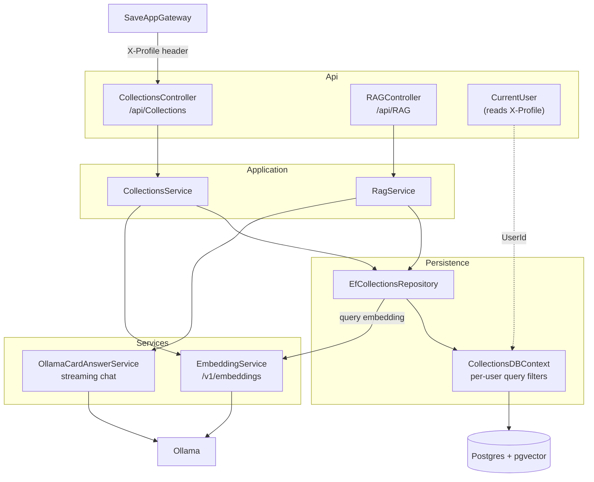
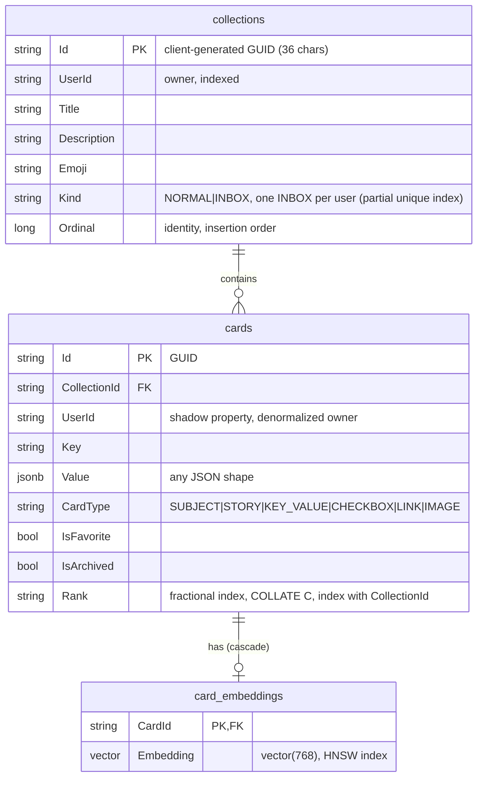
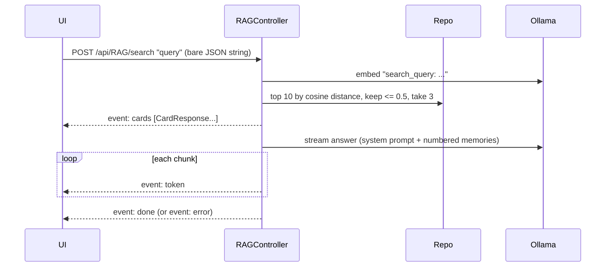

# CollectionsDB (CollectionsService)

The ASP.NET Core 10 backend. It stores users' collections and cards in Postgres, embeds each card with pgvector, and answers chat questions with RAG through a local Ollama model.

## Architecture



Layers: **Api** (controllers, DTO contracts, `CollectionMapper`), then **Application** (use cases), then **Persistence** (EF Core). The `Services/` layer wraps the AI calls.

## Data model



- **Multi-tenancy.** Global query filters on all three tables restrict every query to `ICurrentUser.UserId`. `SaveChanges` stamps the owner on new rows. Repositories never filter by user.
- **Background work.** `CurrentUser` also implements `IUserContext`. Code without an HTTP request (future Kafka consumers) creates a DI scope and calls `Set(userId)`, so the same query filters apply.
- **Inbox.** Each user has one inbox (`Kind = INBOX`). Its ID is a deterministic UUIDv5 of the user ID (`Domain/Collections/InboxId.cs`). `EnsureInboxAsync` creates it on `GET /api/Collections` and `POST inbox`. The first time it runs, it adopts the cards of the old shared inbox `inbox000…` if this user owned it. The inbox is returned first and can't be deleted (DELETE is a no-op returning 204, so the client outbox doesn't get stuck). The `Kind` value sent by the client is ignored.
- **Card order.** Cards sort by `(Rank, Id)` with byte order (`COLLATE "C"`). Ranks are fractional-index keys, always picked by the client and stored as sent; the server never generates one. Content updates never change them, only create and move.
- **Embeddings** are kept in a separate table, so ordinary reads don't load the vectors. The embedded text is `"{Key}: {Value}"`. If embedding fails, the error is logged and the card is still saved without a vector.
- Migrations are in `Persistence/Migrations` and run automatically at startup.

## RAG flow



## API

| Method | Route | Notes |
|---|---|---|
| GET | `/api/Collections` | The current user's collections with their cards. The inbox comes first, and each collection has a `kind`. |
| GET / PUT / DELETE | `/api/Collections/{id}` | `id` must be 36 characters. PUT creates the collection if it is missing (upsert). |
| POST | `/api/Collections` | Create a collection. The client supplies the `id`. Idempotent: an existing `id` is a no-op, so outbox replays never fail. |
| POST / PUT / DELETE | `/api/Collections/{id}/Cards` | DELETE takes the body `{ cardId }`. POST is idempotent on the card `id` and stores the client's `rank`. PUT updates content only and keeps the card's `Rank`. |
| POST | `/api/Collections/{targetId}/Cards/{cardId}/move` | Body `{ rank }` (required). Moves a card to `rank` in the target. Same collection + rank = reorder. The card keeps its ID and embedding. Idempotent. 404 if the card or the target isn't visible to the user. |
| GET | `/health` | Liveness check used by the AppHost. |
| POST | `/api/RAG/search` | Server-sent events (SSE) stream, see above. |

Calling the API directly needs an `X-Profile: {"id":"…","name":"…"}` header. Without it, DB access throws `Unauthorized`.

## Run

```bash
dotnet run                     # Swagger at /swagger (Development)
dotnet tool restore && dotnet ef migrations add <Name> -o Persistence/Migrations
```

Telemetry comes from `builder.AddServiceDefaults()` ([SaveApp.ServiceDefaults](../SaveApp.ServiceDefaults/README.md)): ASP.NET Core, HttpClient, Npgsql and runtime traces/metrics, exported over OTLP when `OTEL_EXPORTER_OTLP_ENDPOINT` is set. Each answer adds an `llm.answer` span with Ollama's timings (`llm.load_ms`, `llm.prompt_eval_ms`, `llm.prompt_tokens`, `llm.eval_ms`, `llm.eval_tokens`, `llm.first_token_ms`) and logs the same numbers.

`LlmWarmupService` loads the answer model in the background at startup (and evaluates the system prompt), so the first search doesn't pay the load. Requests send `keep_alive="-1m"` (Ollama rejects the bare string `"-1"`) and a fixed `num_ctx=4096`; the warm-up must send the same `num_ctx`, because Ollama reloads the model when it changes. All constant instructions live in the system prompt, which Ollama keeps cached, so each search only evaluates the memories and the question. A failed warm-up is only logged.

Configuration: `CollectionsDB:ConnectionString`, `Embedding:Endpoint|Model`, `Llm:OllamaEndpoint|Model`, `Llm:MaxCardChars` (default 3000: each card value in the prompt is cut there and marked `…`, so three cards fit the fixed 4096-token context; on the CPU-only host a full-length card adds ~30 s of prompt reading). Aspire sets these as environment variables.
