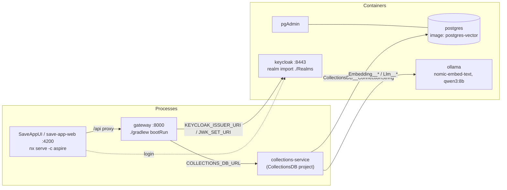

# SaveApp.AppHost

The .NET Aspire orchestrator for local development. One command starts the whole system and wires the services together with connection strings and environment variables.

```bash
aspire run        # from the repo root (aspire.config.json points here)
```

## Architecture



Startup order: `collections-service` waits for the database, and `gateway` waits for Keycloak.

### Telemetry

The Aspire dashboard receives traces, metrics and logs from every service. A click in the browser shows as one trace: save-app-web → gateway → collections-service → Postgres/Ollama.

| Resource | How |
|---|---|
| `collections-service` | [SaveApp.ServiceDefaults](../SaveApp.ServiceDefaults/README.md) |
| `gateway` | OpenTelemetry Java agent, from `WithOtlpExporter()`. Java doesn't trust the dashboard's ASP.NET dev certificate, so `WithCertificateTrustConfiguration` passes Aspire's CA bundle as `OTEL_EXPORTER_OTLP_CERTIFICATE`. |
| `keycloak` | Keycloak's built-in OpenTelemetry. `WithKeycloakTelemetry()` (`KeycloakTelemetryExtensions.cs`) maps the `OTEL_*` values onto `KC_TRACING_*` / `KC_TELEMETRY_*` (including the API-key header), enables the `opentelemetry-logs` and `opentelemetry-metrics` features, and sets `KC_TRUSTSTORE_PATHS` to Aspire's CA bundle. |
| `save-app-web` | Browser SDK, exporting to `/otlp` on the dev server. `WithOtlpExporter(OtlpProtocol.HttpProtobuf)` gives the dev server the dashboard's OTLP/HTTP endpoint and API key, and `proxy.conf.js` forwards `/otlp` there with the key. That endpoint comes from `ASPIRE_DASHBOARD_OTLP_HTTP_ENDPOINT_URL` in `Properties/launchSettings.json`. |

Use `aspire otel logs|spans|traces <resource>` to read telemetry from the terminal.

## Configuration

`appsettings.json` → `App` section:

| Key | Effect |
|---|---|
| `AuthenticationEnabled` | Passed to the gateway as `APP_SECURITY_ENABLED`. |
| `Realm`, `ClientId` | Keycloak realm (`save-app`) and the web client. |
| `KeycloakUrl` / `KeycloakPublicUrl` | Both are accepted token issuers. The public URL is the Tailscale host, which the mobile app uses. |
| `IsPersistent` | When `true`, Postgres and Keycloak get data volumes. When `false`, all data is lost on restart. |

`Realms/save-app-realm.json` is imported into Keycloak at startup. It defines the `save-app` realm, the public PKCE clients `save-app-ui` and `save-app-mobile`, and their redirect URIs (web origins, `capacitor://localhost`, `com.aviv.saveapp:/…`).

## Prerequisites

- Build the Postgres image: `docker build -f CollectionsDB/Dockerfile.postgres -t postgres-vector CollectionsDB`
- `npm install` in `SaveApp-UI/`. The AppHost runs it with `install: false`, so it won't install for you.
- JDK 25 for the gateway.
